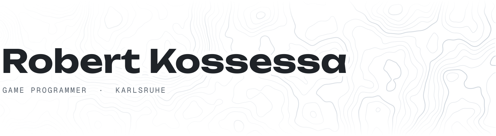

<picture>
  <source media="(prefers-color-scheme: dark)" srcset="assets/header-contours-dark.svg">
  
</picture>

Hi, I'm Robert. I program games at [Chasing Carrots](https://www.chasing-carrots.com/) and make music as [Kosro](https://open.spotify.com/artist/5vA5oxYbi3BCryMa8jh3xr). Mostly Godot these days, with some Rust on the side.

#### Currently building

- A **VR game** inspired by Big Walk and Eye of the Temple, in Godot
- **[Deep Rock Galactic](https://store.steampowered.com/app/548430/Deep_Rock_Galactic/)-style terrain** for Godot, with fragment physics and multiplayer. Fifth rewrite
- A pixel-perfect **[Raycast](https://www.raycast.com/) clone** in Rust
- A battery-powered **Bluetooth handset** made from a 1940s rotary phone

#### Elsewhere

- [**Topple Towers**](https://play.google.com/store/apps/details?id=de.kosro.toppletowers), my physics tower-building game for Android
- [**VRG**](https://mod.io/g/drg/m/vrg), a full VR mod for [Deep Rock Galactic](https://store.steampowered.com/app/548430/Deep_Rock_Galactic/) that I co-developed
- [**Hyperdrive**](https://hyperdrive.buzz), a super-fast disk scanner and visualizer for Windows

 

[kosro.de](https://kosro.de) · [LinkedIn](https://www.linkedin.com/in/robert-kossessa-4189872b2/) · [Bluesky](https://bsky.app/profile/kosro.de)
